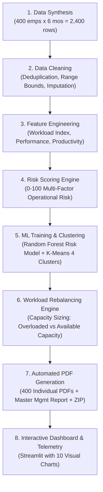

# HDFC BANK — AUTONOMOUS AI EMPLOYEE PRODUCTIVITY, RISK & WORKLOAD PLANNING SYSTEM

[](https://python.org)
[](https://streamlit.io)
[](https://www.reportlab.com)
[](https://scikit-learn.org)

An enterprise-grade, autonomous artificial intelligence workforce analytics and capacity management platform built for **HDFC Bank** operational modeling using **400 completely synthetic employees** across 6 months (2,400 employee-month observations).

---

> ### ⚠️ Academic Research Disclaimer
> *"The performance weights and data used in this project are academic assumptions created for synthetic-data analysis and are not official HDFC Bank employee evaluation criteria. This system is designed as an operational decision-support tool for capacity planning and fatigue prevention, while final personnel decisions remain under human managerial oversight."*

---

## 1. Business Problem & Objective

Banking operations management frequently observes that **employee productivity and quality decline even though working hours and overtime are increasing**. This operational paradox stems from fatigue compounding, cognitive overload, and task maldistribution.

This system:
1. Synthesizes a realistic 6-month operational dataset for 400 employees (`EMP001` to `EMP400`) across 7 bank departments and 5 behavioral archetypes.
2. Executes an automated data cleaning, sanity checking, and imputation pipeline.
3. Engineers explainable business metrics (Workload Index, Task Completion Rate, Overtime Ratio, Absenteeism Rate, Performance Score, Productivity Score).
4. Trains a supervised Random Forest AI risk classifier and an unsupervised K-Means segmentation model.
5. Computes individual employee capacity headroom ($Current\ Workload\ vs.\ Recommended\ Workload$) and generates tailored AI interventions.
6. Automatically generates **400 individual corporate PDF reports** (`EMP001_Report.pdf` to `EMP400_Report.pdf`), an executive management report, and a consolidated ZIP package.
7. Serves an interactive **Streamlit Management Dashboard** featuring 10 operational charts and direct PDF downloads.

---

## 2. System Architecture



---

## 3. Project Directory Structure

```text
HDFC_Employee_AI_System/
│
├── data/
│   ├── synthetic_employee_data.csv       # Raw synthetic dataset with controlled test anomalies
│   └── cleaned_employee_data.csv         # Cleaned, imputed, and feature-engineered dataset
│
├── models/
│   └── productivity_risk_model.pkl       # Serialized Random Forest classifier & K-Means model
│
├── outputs/
│   ├── employee_predictions.csv          # Master employee predictions & capacity metrics
│   ├── workload_recommendations.csv      # Individual task recommendations & action items
│   ├── department_summary.csv            # Department pressure rankings & metrics
│   ├── model_metrics.json                # Accuracy, Precision, Recall, F1 & Confusion Matrix
│   ├── HDFC_Bank_Management_Report.pdf   # Master Executive Management Report
│   │
│   └── employee_reports/
│       ├── EMP001_Report.pdf             # Individual 2-page executive report for EMP001
│       ├── EMP002_Report.pdf             # Individual 2-page executive report for EMP002
│       ├── ...
│       ├── EMP400_Report.pdf             # Individual 2-page executive report for EMP400
│       ├── report_index.csv              # Master directory linking all 400 reports
│       ├── README.txt                    # Folder documentation
│       └── HDFC_Bank_400_Employee_Reports.zip # Consolidated archive of all 400 PDFs
│
├── dashboard/
│   └── app.py                            # Streamlit interactive dashboard
│
├── scripts/
│   ├── generate_data.py                  # Generates 400 synthetic employees over 6 months
│   ├── clean_data.py                     # Data validation, cleaning, and imputation
│   ├── feature_engineering.py            # Feature engineering and performance scoring
│   ├── train_model.py                    # Random Forest training and K-Means segmentation
│   ├── risk_analysis.py                  # Continuous risk scoring and dynamic factor extraction
│   ├── recommendations.py                # Capacity calculation and AI recommendations
│   ├── generate_employee_reports.py      # Batch generation of 400 PDF reports and ZIP archive
│   └── generate_management_report.py     # Executive management PDF report generation
│
├── pipeline.py                           # One-command master pipeline orchestrator
├── requirements.txt                      # Dependencies
└── README.md                             # Project documentation
```

---

## 4. Key Formulas & Business Metrics

### 1. Performance Score (Out of 100)
$$\text{Performance Score} = 0.30 \times \text{Task Completion} + 0.25 \times \text{Quality} + 0.20 \times \text{Deadline Adherence} + 0.15 \times \text{Engagement} + 0.10 \times \text{Previous Performance}$$
- **80 – 100:** High Performance
- **60 – 79:** Moderate Performance
- **< 60:** Low Performance

### 2. Workload Index (0 to 100)
$$\text{Workload Index} = \left( 0.50 \times \text{Norm}(\text{Tasks Assigned}) + 0.25 \times \text{Norm}(\text{Working Hours}) + 0.25 \times \text{Norm}(\text{Overtime Hours}) \right) \times 100$$

### 3. Productivity Score
$$\text{Productivity Score} = 0.40 \times \text{Task Completion Rate} + 0.35 \times \text{Quality Score} + 0.25 \times \text{Deadline Adherence}$$

### 4. Operational Risk Score (0 to 100)
$$\text{Risk Score} = 0.20 \times \text{Overtime Risk} + 0.20 \times \text{Workload Risk} + 0.15 \times \text{Absenteeism Risk} + 0.15 \times \text{Engagement Risk} + 0.15 \times \text{Trend Risk} + 0.15 \times \text{Completion Risk}$$
- **0 – 39:** Low Risk
- **40 – 69:** Medium Risk
- **70 – 100:** High Risk

### 5. Employee Capacity & Workload Rebalancing
$$\text{Capacity Difference} = \text{Recommended Tasks} - \text{Current Tasks}$$
- **Overloaded:** Difference $\le -4$ tasks (e.g. Current = 54, Recommended = 44 $\rightarrow$ Shed 10 tasks)
- **Balanced:** Difference between $-3$ and $+3$ tasks
- **Available Capacity:** Difference $\ge +4$ tasks (e.g. Current = 30, Recommended = 42 $\rightarrow$ Absorb 12 tasks)

---

## 5. One-Command Full Automation

Run the end-to-end pipeline with a single command:

```bash
python pipeline.py
```

This autonomously executes:
1. Generation of 400 synthetic employees across 6 months (2,400 records).
2. Data cleaning, outlier winsorization, and type imputation.
3. Feature engineering and business metric calculation.
4. Operational risk scoring and factor attribution.
5. Random forest training and K-Means segmentation (4 clusters).
6. Capacity sizing and dynamic recommendation generation.
7. Generation of **exactly 400 individual PDF reports** in `outputs/employee_reports/`.
8. Packaging of all 400 reports into `HDFC_Bank_400_Employee_Reports.zip`.
9. Generation of master report directory `report_index.csv`.
10. Generation of the comprehensive `HDFC_Bank_Management_Report.pdf`.
11. End-of-pipeline validation suite confirming 100% integrity.

---

## 6. Interactive Streamlit Dashboard

To launch the management dashboard:

```bash
streamlit run dashboard/app.py
```

### Features:
- **8 Executive KPI Cards:** Total Headcount, Avg Performance, Avg Productivity, Avg Overtime, Avg Engagement, Risk Breakdowns.
- **10 Core Visualizations:**
  1. Operational Risk Distribution (Pie/Donut)
  2. Performance by Department (Horizontal Bar)
  3. Overtime vs Performance (Scatter with Regression Trendline)
  4. Workload Index vs Performance
  5. Engagement vs Performance
  6. Absenteeism vs Performance
  7. Monthly 6-Month Performance & Overtime Trends
  8. Department Risk Tier Stacked Comparison
  9. Employee Behavioral Clusters (K-Means Scatter)
  10. Top Predictive Risk Drivers (Feature Importance)
- **Individual Employee Inspector:** Select any of the 400 employees, inspect live metrics, and click **Download Employee PDF Report**.
- **Batch Export:** One-click download of all 400 reports as a consolidated ZIP file and the Executive Management Report PDF.
